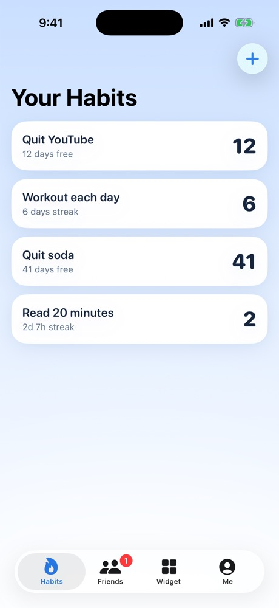
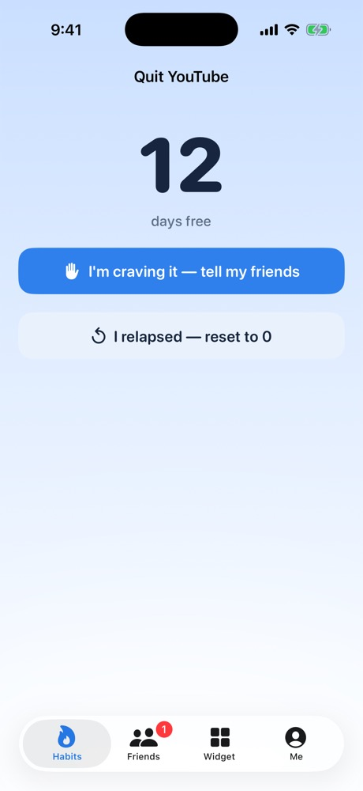
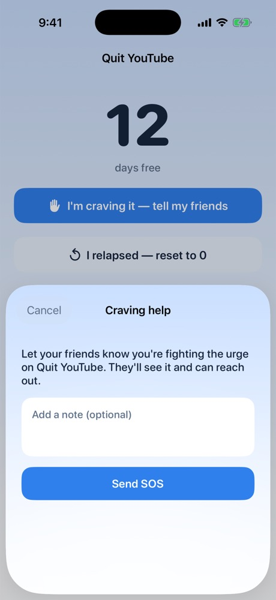
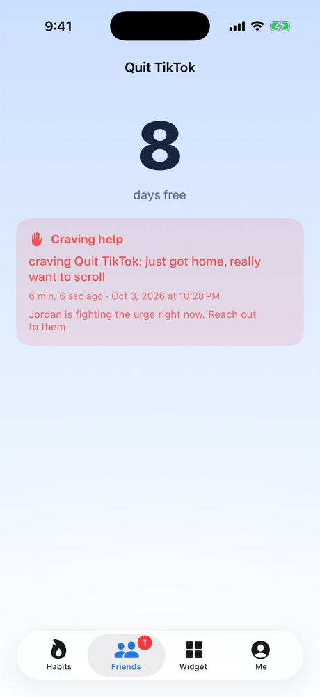

# Quit With Help

An iPhone app for quitting bad habits and building good ones, with friends who
show up when you're craving. Track a habit, watch a live counter, and when an
urge hits, tap one button to let your friends know so they can reach out.

Built for the 2026 Congressional App Challenge.

## Features
- **Sign in** with Apple, or **Continue as guest** (Firebase anonymous auth).
- **Two habit modes:** *Quit something* (time free) or *Build a habit* (streak).
  Live counter down to the second.
- **Craving SOS:** "I'm craving it — tell my friends" with an optional note.
  Friends get a notification, a red badge, and "needs a hand right now".
- **Honest resets:** resetting a habit tells your friends.
- **Friends:** follow each other with a 6-character share code.
- **Widget:** small / medium / large Home Screen widget with your streaks and
  friend alerts.

## Run it
1. `open quitwithhelp.xcodeproj`
2. Pick an iPhone simulator or your phone, press **⌘R**.
3. Widget: long-press the Home Screen → **+** → search "Quit With Help".

Regenerate the project with `xcodegen generate` after editing `project.yml`.

Screenshot mode (debug builds): launch with env var `QW_DEMO=<screen>`
(`auth`, `habits`, `detail`, `sos`, `friends`, `friendCraving`, `widget`, `me`, …)
to show a screen with sample data and no sign-in.

## Stack
- Swift + SwiftUI, iOS 17+
- Firebase Auth (Apple + anonymous) and Cloud Firestore
  (`ac_profiles`, `habits`, `follows`)
- WidgetKit + App Intents. The app writes a snapshot to the App Group
  `group.com.quitwithhelp`, and the widget reads it (the widget doesn't use Firebase).

## Structure
- `Shared/` — models + snapshot I/O (compiled into the app **and** the widget)
- `App/` — SwiftUI screens, `HabitStore` (Firestore), `Firebase/` auth
- `Widget/` — the WidgetKit extension
- `project.yml` — xcodegen spec

## Next (2.0)
- Real push notifications (FCM + Cloud Function) so an SOS reaches a locked phone
- Quick replies to an SOS, craving insights, groups, privacy controls
- Let guests link their account to Apple and keep their data

## Firebase setup
`App/GoogleService-Info.plist` is not in this repo. To run the app, create a
Firebase project, add an iOS app with bundle ID `com.quitwithhelp`, download
its `GoogleService-Info.plist` into `App/`, and enable the **Apple** and
**Anonymous** sign-in providers plus Cloud Firestore.
